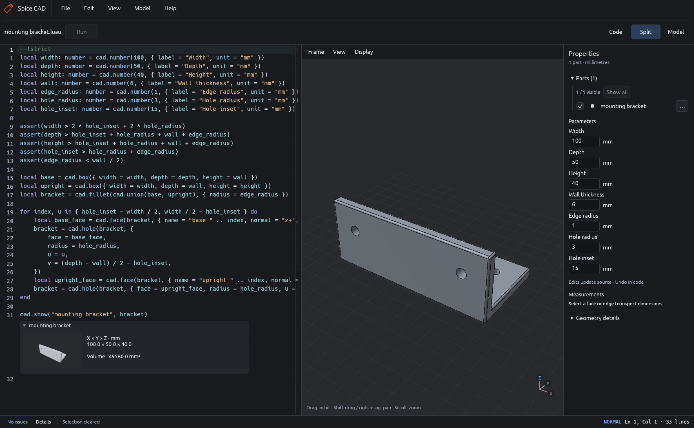
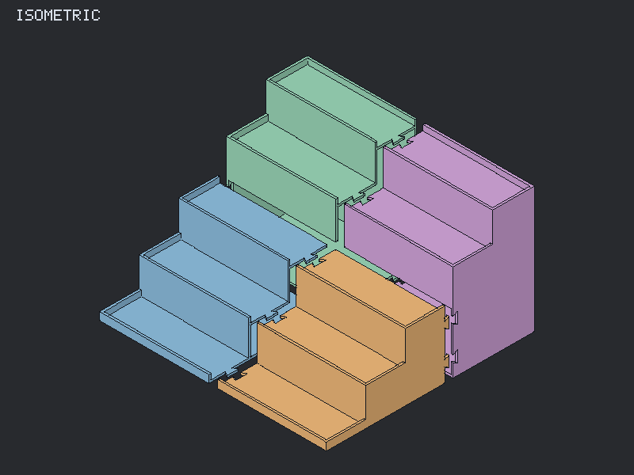
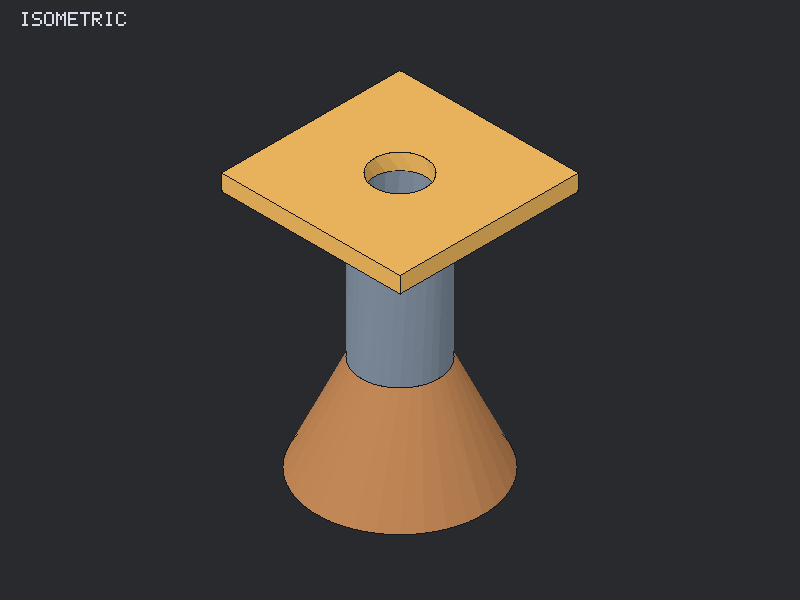

# Spice CAD

Native CAD driven by typed Luau scripts, by [Holy Furries Studio](https://holyfurries.com).
Write shapes in code, adjust parameters in the UI, and export parts for 3D printing
or simple game assets. Built with Rust, SMLib, and egui/wgpu.



## Start

On Linux, with [Nix](https://nixos.org/download/) and flakes enabled, run from this checkout:

```sh
nix run .#spice-cad
```

The first launch builds the app. It opens a four-part spice rack; choose another
model under **File → Examples**, or use **File → Open** for your own `.luau` file.
To install it: `nix profile install .#spice-cad`.

[Experimental Linux downloads and release instructions](docs/releases.md)
cover running an AppImage without Nix.

## Model with code

```lua
--!strict
local width: number = cad.number(80, {
    label = "Width", min = 20, max = 120, unit = "mm",
})
local plate = cad.box({ width = width, depth = 50, height = 8 })
cad.show("Plate", cad.fillet(plate, { radius = 2 }))
```

`cad.number` exposes a property; adding `min` and `max` gives it a slider.
Edits update the preview automatically. All model lengths are millimetres.

- Build solids with booleans, extrusions, revolutions, fillets, and chamfers.
- Name faces, inspect dimensions, and add holes, pockets, and bosses.
- Edit with Vim-style keys, syntax highlighting, completion, and diagnostics.
- Give parts separate assembly and print placements without rebuilding geometry.

Drag to orbit, Shift-drag to pan, and scroll to zoom. Click a face to inspect it;
press **F** over the viewport to frame the model.

## Print or use in a game

| Four-part spice rack                                                                           | Multipart rocket engine                                                                    |
| ---------------------------------------------------------------------------------------------- | ------------------------------------------------------------------------------------------ |
|  |  |
| [Rack source](models/rack-parts.luau)                                                          | [Engine source](models/rocket-engine.luau)                                                 |

Use **File → Export**:

- **3D print · STEP + STL** writes separate parts in their print placements.
  Import STLs into your slicer as millimetres. The rack example splits into four
  parts for the Bambu Lab P1S; [printing and assembly notes](docs/spice-rack.md#print-and-assemble-on-the-p1s)
  cover joint fit samples and orientation.
- **Game asset · GLB** writes the assembly with named parts and colors.

## Develop

```sh
nix develop
cargo run --release --locked
cargo test --locked
```

The native app is the default Cargo target. This is an actively developed tool;
the Nix package currently targets Linux.
Independent OpenCascade checks live in test-only tooling; see
[kernel verification](docs/kernels.md#independent-verification).

## Guides

- [Editor and controls](docs/native-editor.md)
- [Modeling and exports](docs/modeling.md) · [Measurements and named faces](docs/measurements.md)
- [Sweeps, lofts and shells](docs/shape-operations.md)
- [Reusable typed Luau modules](docs/luau-projects.md)
- [Spice rack design and printing](docs/spice-rack.md)
- [Print checks and fit calibration](docs/printing.md)
- [Performance and profiling](docs/performance.md)
- [Browser prototype](docs/browser-prototype.md) · [Kernel evaluation](docs/kernels.md)

The [typed CAD API](native/types/cad.luau) and [example models](models/) are the
reference for writing scripts. Detailed implementation notes live in [evaluation/](evaluation/).

## License

Code and examples: [MIT](LICENSE). Artwork and branding: [separate terms](ASSETS.md).
Dependency attributions: [NOTICE](NOTICE).
