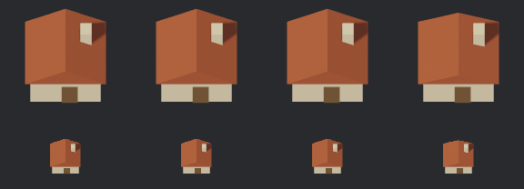
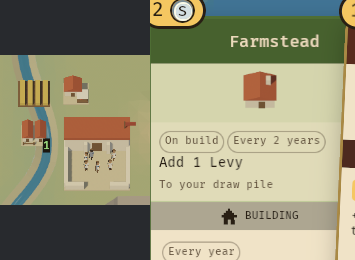

# Crowns Adrift export acceptance

Verified 23 October 2026 against Bevy 0.19.1 and the game's `8d93fdf` farmstead
trial. Tests used an isolated game worktree, its existing baker, and an RTX 3070
Vulkan renderer (NVIDIA 595.104.02). Production game sources and approved sprites
were not changed.

## Strict loading and orientation

All nine export/import fixtures pass with normal validation enabled: farmstead,
asymmetric facing marker, and nested grip/equipment frames, each with default,
game-preset, and rotated settings. The gate checks source and GLB hashes, loaded
materials, local transforms, hierarchy, counts, and final world bounds.

The scoped gltf-json correction preserves Bevy's raw specular data. Tests also
confirm unknown required extensions and malformed documents are rejected.
Farmstead materials load with IOR 1 and reflectance 0; required extensions remain
in the GLB. See [the contract and consumer correction](game-asset-contract.md).

| Farmstead export | Import scale | Roof width | RGBA pixels differing from procedural bake |
| --- | ---: | ---: | ---: |
| Default miniature | 10, read from metadata | 1.15 | 0 |
| Crowns Adrift preset, export scale 10 | 1, identity wrapper | 1.15 | 0 |

Both retain alpha bounds `(19, 1, 109, 106)`, with right/bottom exclusive, and zero
nontransparent pixels on the image border. Camera, lighting, materials, ground
anchor, transparency, MSAA, and tonemapping remain the existing baker's settings.
This is renderer-specific observed parity, not a cross-GPU guarantee.

## A real authoring edit

The farmstead now exposes **Roof rise** alongside Scale. Its default remains
40 mm. The candidate changes only that rise to 28 mm, keeping the footprint,
materials, ground anchor, four parts, 44 triangles, and 90 GPU vertices.

Columns: procedural, default export, game-preset export, lower-roof candidate.
Top: native 128×128 bakes. Bottom: 48×48 nearest-neighbour size checks. The
candidate changes 5,166 RGBA pixels and has alpha bounds `(19, 6, 109, 106)` with
zero occupied border pixels. It remains **unreviewed art**.

These crops preserve native pixels from an actual 1600×900 game capture after
three bot seasons, seed 1. The isolated asset root substitutes only the candidate
farmstead PNG. Infantry, animation, equipment swapping, and live-3D crowds remain
outside this acceptance result.

## Handoff and reproduction

The complete local handoff is `output/crowns-adrift-contract/handoff/`. Both
`farmstead/` and `farmstead-lower-roof/` contain editable source, GLB, generated
metadata, a SHA-bound `target-loader.json`, and transparent 128/48-pixel references.
It also contains the consumer patch, licensed validator source, comparison, and
native game crops. The patch targets game commit `8d93fdf`; it enables strict
validation and reads display scale from `asset.json`.

GLB SHA-256 identifiers:

- Game-preset original: `f2ed5a7cc3bf27bd5bc7e8ffd00a928f2799ad65afa1ac6f9a70f9592780b3d4`.
- Lower-roof candidate: `bd429bddead9d66a6b28f9edbdade4003eaa895803791684387f9f092152c670`.

Run the [nine-fixture gate](game-asset-contract.md#strict-target-loader-gate) for
fresh bundles and reports. For rendered checks, apply the supplied patch to an
isolated game checkout, copy `gltf-json/` to `vendor/gltf-json/`, and place a
bundle's GLB and metadata under `art/source/spice/farmstead/`. Run the game's
`DIORAMA_SPICE=1 DIORAMA_EXPORT=NEW_DIRECTORY` baker command from its trial report.
Inspect both the transparent bake and a separate game asset root before changing
approved sprites.
