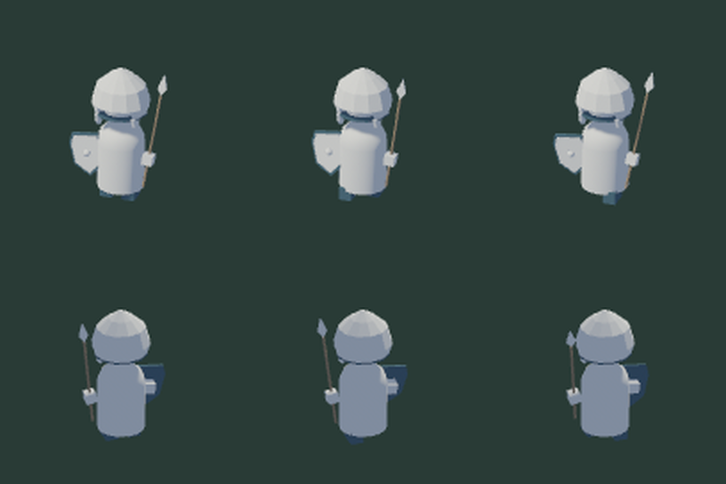

# Infantry levy sprite handoff

The original Spice CAD infantry now has idle and two rigid stride poses. The
six transparent 128×128 PNGs use Crowns Adrift's existing levy filenames:

```text
units/levy.png
units/levy-step-left.png
units/levy-step-right.png
units/levy-back.png
units/levy-back-step-left.png
units/levy-back-step-right.png
```

## Use in the game

The complete local bundle is `output/infantry-levy/`; its archive is
`output/infantry-levy-handoff.tar.gz`. Copy only its six `units/*.png` files into
the game's `crates/client/assets/units/`. Existing frame selection, right-facing
mirroring, linear sampling, opacity, and combat movement remain game-owned.
Back up the existing sprites or make the replacement on a game branch.
No runtime GLB loader, skeleton, material conversion, or additional scale is
needed for these baked sprites.

The bundle includes three editable source/GLB/metadata sets, SHA-bound strict
loader reports, a PNG audit, previews, the bake adapter, and the MIT license.
These are a playable art candidate, not an approved replacement for the game's
blue-and-bronze levy palette. The porcelain-and-blue design remains unchanged.



## Pose and sizing contract

`examples/infantry.luau` exposes **Stride**: 0 idle, +1 left step, −1 right step.
Boots slide in opposing directions; the shield and spear counter-swing through
their grip frames. All geometry remains cached across stride changes. Head,
shield, and weapon frames declare attachment roles; they are not bones.

All three sources share the ground plane and one uniform bake-time scale.
The consumer adapter chooses the existing levy's 1.025-unit helmet height and
divides it by the GLB's measured **body reference height** (currently 0.0546 metres).
This excludes the spear and follows changes to body proportions. Do not
independently fit each pose or apply display-size suggestions.
Exports retain neutral metres and their complete hierarchy.

Camera focus is `(0, 0.59, 0)`, front/back offsets are `(2.5, 4, ±7)`, and the
orthographic vertical span is 1.65. Lighting, Reinhard tonemapping, four-sample
MSAA, and linear-space alpha unpremultiplication come from the existing baker.
The back view changes the camera, not the model's handedness or equipment.

## Reproduce

The current recipe uses [named poses and cached batch export](pose-exports.md).
New outputs live under `models/{idle,step-left,step-right}/`, with a shared
animation library at `models/model.glb`. It no longer rewrites stride literals.
The supplied adapter reads body references directly from the GLB; no companion
JSON is copied into the game. Historical archives and the existing game trial
remain unchanged. Adopting this adapter is a separate game-side integration.

For the supplied adapter, use a graphical session and an isolated game worktree
at `45df40f`. Apply
`tools/game-import/fixtures/infantry-baker.patch` there; the existing strict
validator correction is already included in that game revision. Build its
`tribute-client` diorama example with `--features diorama` under its Nix shell:

```sh
nix develop -c cargo build --locked -p tribute-client --example diorama --features diorama
```

The historical archive is also pinned to `45df40f`. Its README and checksums
remain immutable provenance. The current game package is `crowns-adrift-client`;
its trial branch already has an adapter, so do not reapply this patch there.

From Spice CAD, build the exporter, validator, and recipe:

```sh
nix develop -c cargo build --locked -p spice-cad
nix develop -c cargo build --locked --manifest-path tools/game-import/Cargo.toml --bin spice-game-import --example infantry-bakes
nix develop -c tools/game-import/target/debug/examples/infantry-bakes \
  target/debug/spice-cad tools/game-import/target/debug/spice-game-import \
  /tmp/spice-levy /tmp/spice-levy/target/debug/examples/diorama output/levy-new
```

The game checkout must be a linked worktree and each destination must be new.
The recipe copies three bundles into its `art/source/spice/`, strictly validates
them, invokes the patched baker, and selects only the six levy sprites. It
rejects empty, duplicate, clipped, or incorrectly sized PNGs and bounds each
subprocess to 120 seconds. Generated assets stay outside Git.

## Game-side palette and encounter trial

The game's `art/infantry-levy-trial` branch now retains these source bundles and
bakes the six levy sprites with its existing blue tunic, bronze equipment, linen
shield, skin and wood palette. Original GLB materials and the archived handoff
remain unchanged. Palette assignments and display scale belong to the game baker.

That branch already includes the infantry adapter. Do not reapply the fixture
patch or copy bundles over its tracked sources. Bake directly from the game:

```sh
DIORAMA_INFANTRY=1 DIORAMA_EXPORT=/tmp/levy-bake nix develop -c cargo run -p crowns-adrift-client --features diorama --example diorama
```

Only copy the six `units/levy*.png` outputs. The game records source/license
provenance, corrected PNG hashes, pose previews and sampled active-encounter
captures in `docs/spice-infantry-trial.md`. The natural veterans-policy replay
uses Mycenae, seed 1, at action 20 before ending year four, with a friendly levy
and two coastal raiders. Its 21 resulting action hashes match the baseline.
Foot motion remains subtle at army scale; sampled captures establish movement
and return to idle, not full-frame-rate smoothness or final art approval.
