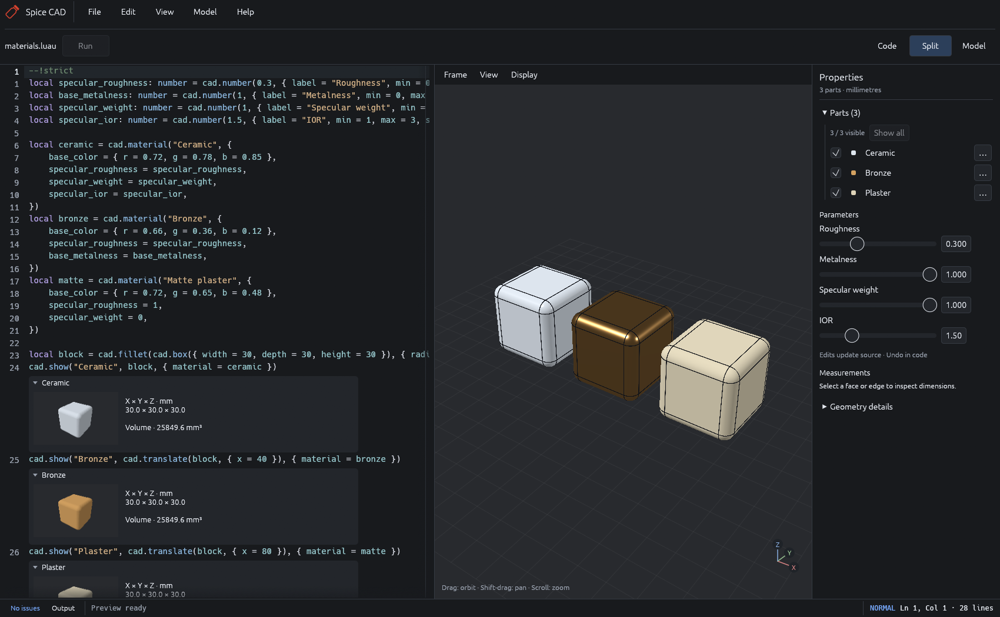
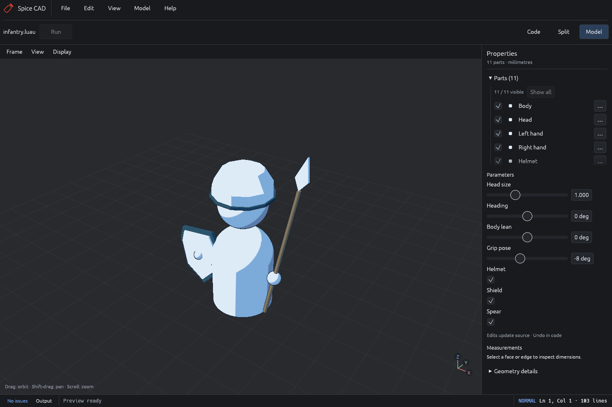
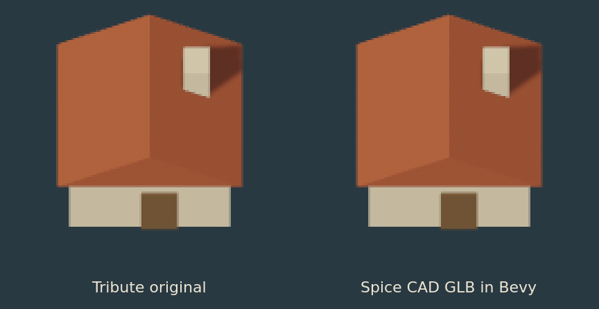

# Modeling with Luau

[← Spice CAD](../README.md) · [Editor](editor.md) · [Printing](printing.md)

The [typed CAD declarations](../crates/spice-cad/types/cad.luau) define the API;
[examples](../examples/) provide runnable models. Use `--!strict` and annotate
factory functions for useful diagnostics and completion. Lengths are millimetres,
angles are degrees, and X/Y/Z mean width/depth/height.

## Define solids and properties

```lua
--!strict
local width: number = cad.number(80, {
    label = "Width", min = 20, max = 120, step = 1, unit = "mm",
})
local plate = cad.box({ width = width, depth = 50, height = 8 })
cad.show("Plate", cad.fillet(plate, { radius = 2 }))
```

Top-level literal `cad.number` declarations appear in Properties. Both `min` and
`max` enable a slider; otherwise the control is a numeric field. `cad.toggle`
creates a checkbox. Controls edit the source literal, and each slider drag is one
undo step. Enter or leaving a field applies its value; Escape cancels the draft.
Use ordinary locals for values that should stay private. Cross-property rules
belong in `assert` calls or explicit measurement checks.

| Operation | Usage |
| --- | --- |
| Box | `cad.box({width=40, depth=20, height=8, x=0, y=0, z=0})` |
| Cylinder, along +Z | `cad.cylinder({radius=5, height=20})` |
| Boolean union / difference | `cad.union(a, b)` / `cad.subtract(a, b)` |
| Translate | `cad.translate(part, {x=10, z=4})` |
| Rotate about the source origin | `cad.rotate(part, {axis="z", angle=90})` |
| Fillet / Chamfer | `cad.fillet(part, {radius=2})` / `cad.chamfer(part, {width=1})` |

Box coordinates specify its minimum corner; cylinder coordinates specify its base
center. Operations return new recipes, so operands can be reused. Transforms
inside a construction change geometry; finished-part placements below are cheaper.

To treat selected straight edges, create `cad.edge(part, {name=..., from=...,
to=...})` handles and pass `edges={handle}` to fillet or chamfer. Endpoints use
source-local coordinates. Select handles on the exact input solid; handles from
an earlier solid are invalid after another modeling operation.

## Materials

Define a named material once and share it between parts:

```lua
local roughness: number = cad.number(0.3, { label = "Roughness", min = 0, max = 1, step = 0.01 })
local plaster = cad.material("Plaster", {
    base_color = { r = 0.85, g = 0.72, b = 0.45 },
    specular_roughness = roughness,
    base_metalness = 0,
    specular_weight = 0,
})
cad.show("Wall", cad.box({ width = 40, depth = 5, height = 30 }), { material = plaster })
```

Spice implements an opaque, isotropic, in-air parameter subset of
[OpenPBR Surface 1.1.1](https://academysoftwarefoundation.github.io/OpenPBR/),
with explicit renderer and export approximations. This is not full OpenPBR BSDF
conformance or a MaterialX importer. Materials are immutable reusable values.
`cad.show` takes `material`, replacing the former `color` option.

| OpenPBR parameter | Supported values | Default |
| --- | --- | --- |
| `base_color` | Linear RGB channels in [0, 1], not sRGB | (0.8, 0.8, 0.8) |
| `base_metalness` | [0, 1] | 0 |
| `specular_roughness` | [0, 1]; microfacet alpha = roughness² | 0.3 |
| `specular_weight` | [0, 1]; must equal 1 if metalness > 0 | 1 |
| `specular_ior` | [1, 3] | 1.5 |

All numbers must be finite. The weight modulates normal-incidence dielectric
reflectivity by changing IOR, as specified by OpenPBR; it is **not** glTF's
`specularFactor`. For reference IOR `n`, `F0 = ((n-1)/(n+1))²`,
`e = sqrt(specular_weight * F0)`, and effective IOR is `(1+e)/(1-e)`.
Weight 0 gives effective IOR 1 and no dielectric specular reflection. IOR 1.5
with weight 0.25 gives effective IOR 1.222222 and F0 0.01.

The profile fixes base weight to 1, diffuse roughness to 0, specular tint to
white, and anisotropy, transmission, subsurface, coat, fuzz, and emission to 0.
Unsupported parameters are rejected even when explicitly set to neutral values.
Non-unit metallic specular weight is rejected because glTF's specular factor
does not weight its metallic lobe. Weights above 1 and IORs outside [1, 3] are
also outside this subset. The earlier `roughness`/`metallic`/`specular` aliases
are removed so their different semantics cannot be mixed accidentally.

**File → Examples → Materials** compares ceramic, bronze, and matte plaster.
Its top-level numeric controls edit surface properties without rebuilding solids,
retessellating, or replacing the viewport geometry buffers. Hover a part in
Properties to inspect its material name and values.



The viewport uses exact dielectric Fresnel at the effective IOR and isotropic
GGX, with fixed studio lights. Roughness is clamped to 0.045 for preview stability.
It omits OpenPBR's multiple-scattering compensation and layered diffuse-albedo
normalization, as well as environment reflections. Inline thumbnails and headless
view renders remain color-only diagrams.

GLB maps base color, metalness, and roughness directly. Effective IOR uses
`KHR_materials_ior`; effective IOR 1 additionally uses `KHR_materials_specular` factor 0
to preserve a purely diffuse surface in Schlick-based engines. Necessary
extensions are marked required. Original supported parameters and spec version
are retained in `materials[].extras.spice_cad` as application metadata, not a
standard OpenPBR interchange extension. `GAME_ASSET.md` explains that glTF's
Schlick Fresnel and engine-dependent compensation make general shading lossy;
rendered appearance equivalence is not claimed. Regression tests cover defaults,
reference IOR/F0 values, GLB mappings, metadata, and unsupported cases.

## Profiles, extrusions, and revolutions

```lua
local section = cad.polygon({
    {x=5,y=0}, {x=12,y=0}, {x=12,y=20}, {x=5,y=20},
})
cad.show("Bushing", cad.revolve(section, {angle=360}))
```

`cad.polygon` closes a sequence of 2D vertices. `cad.circle({radius=5})` produces
a circular profile. `cad.path` combines lines and arcs: each segment has a `to`
point; arcs also specify `center` and optional `clockwise`. `cad.profile({loops=
{outer, hole}})` groups nested loops for supported extrusions. Loops must be
closed, nonintersecting, and consistently nested.

`cad.extrude(profile, {height=6})` extrudes along +Z. `cad.revolve` interprets
profile X as radius and Y as world Z, revolving from +X toward +Y around +Z.
Omit `angle` for a full turn; angles from 0.1° to 360° create capped sectors.
Radii must stay within 0–1000 mm; touching the axis is allowed, crossing it is not.
See [extruded bracket](../examples/extruded-bracket.luau),
[rounded enclosure](../examples/rounded-enclosure.luau), and
[revolved bushing](../examples/revolved-bushing.luau).

## Sweeps, lofts, and shells

```lua
local elbow = cad.sweep(cad.circle({radius=3}), {
    path = {{x=0,y=0,z=0}, {x=0,y=0,z=40}, {x=40,y=0,z=40}},
    bend_radius = 12,
})
```

Sweeps accept a polygon or full circle and 2–64 points forming an open planar
path. The profile center follows the path, perpendicular to its initial tangent;
ends are capped. Omit `bend_radius` for mitered corners. Supplying it inserts
exact tangent circular bends (G1 continuity). The radius must exceed the profile
footprint, with 0.01 mm of straight length left between bends and ends. Total
path length is limited to 4000 mm. Reversals, close nonadjacent segments, nested
profile loops, twisting, scaling, and nonplanar or freeform spline paths are
unsupported. See [smooth sweep](../examples/smooth-sweep.luau).

```lua
local body = cad.loft({
    {profile=cad.circle({radius=12}), z=0},
    {profile=cad.circle({radius=14}), z=12},
    {profile=cad.circle({radius=10}), z=28},
    {profile=cad.circle({radius=6}), z=40},
}, {degree=3})
```

Lofts accept 2–16 convex single-loop profiles in parallel XY planes. Section
heights increase by at least 0.01 mm; `x` and `y` add section offsets. Corresponding
edges, arc sweeps, and seams must match. Holes, concave sections, and transitions
between circles and polygons are unsupported. Default degree is 1; degrees 2/3
need at least 3/4 sections. Curved lofts may bulge between sections, so inspect
bounds. See [curved loft](../examples/curved-loft.luau).

`cad.shell(part, {thickness=2, open=face})` hollows inward while retaining the
outside shape. Omit `open` for an enclosed cavity, or select one axis-aligned
planar face for the opening. Thickness must be less than half the smallest bound;
local features can impose tighter limits. Shell before applying fillets when
possible. See [shape operations](../examples/shape-operations.luau).

## Named faces and design checks

```lua
local height = cad.number(20, {label="Height", unit="mm"})
local part = cad.box({width=40, depth=30, height=height})
local top = cad.face(part, {name="top", normal="z+"})
local bottom = cad.face(part, {name="bottom", normal="z-"})
cad.measure("height", {from=bottom, to=top, min=2, max=25, parameter="height"})
cad.show("Measured block", part)
```

Face selectors match an outward normal (`x+`, `x-`, `y+`, `y-`, `z+`, `z-`). Add
`at` to filter the coordinate along that axis, or `near={x=...,y=...,z=...}` to
choose the closest matching face center. Ambiguous or missing faces fail the
build. Names and selectors are reevaluated after each rebuild; numeric face IDs
are not persistent references. Named measurements require faces of final shown
solids. Select intermediate solids only when making another modeling operation.

`cad.measure` reports separation between parallel planes. Without limits it is
a reference dimension; `min` or `max` makes it a design check that blocks export
on failure. An optional `parameter` names a top-level numeric control for editing
from a dimension label. This association does not assert that the parameter
equals or drives the dimension, and it does not invert formulas.

Measurements use the preview mesh, display `≈`, and allow 0.001 mm plane/check
tolerance. They are bounded preview checks rather than exact kernel metrology.
Up to 64 named faces and 64 scripted measurements are supported. Deterministic
code does not prove fit, strength, or manufacturability; there is no sketch
constraint solver or automatic fully-constrained classification.

## Face-based features

```lua
local part = cad.box({width=60, depth=30, height=8})
local top = cad.face(part, {name="mounting face", normal="z+"})
part = cad.hole(part, {face=top, radius=2, u=-20, v=0})
cad.show("Mount", part)
```

Holes cut inward; omit `depth` for a through-hole or supply it for a blind hole.
Offsets start at the selected face's bounding-box center. X-normal faces use
+Y/+Z for `u/v`; Y-normal faces use +X/+Z; Z-normal faces use +X/+Y. The axes are
the same for either normal sign. Centers outside the trimmed face or inside an
opening fail; a circle may overlap a boundary to create an open cut.

Add `counterbore={radius=4,depth=2}` or `countersink={radius=4,angle=90}` for a
screw seat. Recess radius must exceed hole radius; countersink angles are included
angles. Select a fresh face from the resulting solid before another operation.
`cad.pocket` cuts inward and `cad.boss` adds outward, using the same face axes.
Supply `width`/`height` or a polygon `profile`, plus `depth` and optional `u/v`.
See [manufacturing panel](../examples/manufacturing-panel.luau).

## Part placements and assemblies

```lua
local plate = cad.box({width=30, depth=20, height=4})
cad.show("Plate", plate, {
    assembly = {position={z=40}},
    print = {rotation={x=90}, position={y=4}},
})
```

Use unique `cad.show` names. Rotations apply about the solid's source origin in
X/Y/Z order, followed by translation. Omitted assembly placement means identity.
If any part declares `print`, every part needs one (`print={}` means identity).
Without print placements, print exports use assembly placements. Changing finished
part placements reuses geometry; switching layouts changes transforms only.

Selectors use local geometry coordinates. Scripted checks use assembly coordinates,
even in Print layout; direct selection measures the displayed placement. Print
exports use print placement, while game exports use assembly placement. Visibility
only affects the viewport. The model supports at most 32 named parts.

## Local modules

```lua
-- main.luau
local bracket = require("./bracket")
cad.show("Bracket", bracket({width=30}))
```

The entry file's directory is the project root; no manifest is needed. Literal
relative imports resolve from their importer, with an optional `.luau` extension.
Nested imports may use `./../` inside the root. Absolute paths, packages, dynamic
imports, cycles, and symlinks escaping the root are rejected. Projects have at
most 64 files and 4 MiB combined source.

Modules return a value, commonly a typed factory function. They can use `cad`
directly and share the execution budget. An executed `require` runs the module
once; repeated imports share its result. Keep controls and `cad.show` calls in
the entry file. Exported types and function annotations work across modules.

Imported edits invalidate analysis and preview caches. Exports include staged
module files with rewritten import paths; keep these with `model.luau` to rebuild
the exported snapshot. **File → Examples → Reusable typed modules** installs the
[modular example](../examples/modular/main.luau) without overwriting personal edits.

## Exports and headless commands

```sh
cargo run --release --locked -- --check-model examples/mounting-bracket.luau
cargo run --release --locked -- --render-views examples/rack-parts.luau output/views
cargo run --release --locked -- --export-game examples/rocket-engine.luau output/engine
```

Run Cargo from `nix develop`. Output directories must be new. Game export writes
`model.glb`, the source graph, and `GAME_ASSET.md`. GLB uses separate named objects,
shared PBR materials, and hard boundaries between CAD faces. Coordinates convert to
right-handed Y-up metres: `(x,y,z)` becomes `(x,z,-y)/1000`. Each mesh keeps its
local source coordinates and origin; assembly placement becomes the object's
translation and quaternion rotation in GLB. Author a limb around its joint at
`(0,0,0)` and place it with `assembly` to preserve a usable shoulder or hip pivot.
Changing a pose changes node transforms without changing mesh vertex data.
Named groups preserve their parent-child hierarchy; unparented parts remain roots.
Skeletons and animation clips are not generated. Game exports have no print-bed requirement; closed meshes and declared
checks still apply.

Game tessellation uses 0.25 mm chord / 30° angular tolerances, with no fixed polygon
budget or automatic LOD generation. UVs, textures, collision meshes, rigging, and
animation are unsupported. [Printing](printing.md) uses finer tessellation and
separate bed placements.

## Parented attachments

`cad.group("Grip", {parent=body, assembly={position={x=12}}})` creates a named
transform group. `parent` accepts an earlier group handle; omit it for a root.
Pass the handle to `cad.show` with `parent=grip`. Assembly placements are local
to their parent, and transforms compose from the root to the part. Groups may
contain parts and other groups; up to 32 groups and 16 levels are supported.

Changing a group placement updates its descendants without rebuilding their
solids or tessellation. Named measurements, picking, and bounds use the composed
world placement. An explicit `print` placement remains independent of the group;
without print placements, printing uses the composed assembly placement.

GLB preserves group nodes, children, and local translations/rotations. Parts stay
separate meshes. The Parts panel currently lists individual parts; groups are
authored in Luau rather than manipulated through an editable hierarchy tree.
Duplicate group names, invalid parents, excessive depth, and composed positions
outside ±2,000 mm are rejected. Immutable handles can only reference existing
groups, so scripts cannot create parent cycles.

## Rounded primitives

`cad.sphere({radius=7})` creates an exact sphere centred at the source origin.
Optional `x`, `y`, and `z` position its centre. `cad.capsule({radius=9, height=34})`
creates a Z-aligned cylinder with hemispherical ends; its origin is the bottom
tip, and height includes both caps. Height must be at least twice the radius;
equality creates a sphere centred one radius above the base.

Radii accept 0.01–500 mm, capsule height accepts up to 1,000 mm, and primitive
bounds must remain within ±2,000 mm. Capsules use one analytic rotational sweep
without boolean unions. Both primitives support normal CAD operations, exact
volume queries, STEP/STL exports, and cached preview geometry. Display and game
meshes use the existing tessellation tolerances; no fixed polygon count is implied.

## Explicit low-poly profiles

`cad.regular_polygon({radius=10, sides=8, rotation=22.5})` creates a centred
polygon profile with exactly eight sides. Radius is the distance to a corner in
millimetres; rotation is in degrees and defaults to zero. Side counts must be
integers from 3–128, radius must be 0.01–500 mm, and the usual profile limits
still apply (including a 0.01 mm minimum edge length).

Extrude it for faceted cylinders or connect profiles with `cad.loft` for tapered
torsos, helmets, and equipment. Polygon sides remain authored geometry in the
viewport, STEP/STL, and GLB; curved-surface tessellation does not choose their
side count. Use `shading={mode="flat"}` for visible facets.

## Bevels and mesh shading

Open **File → Examples → Bevels and shading** for a beveled block beside flat
and smooth cylinders. Bevel width and crease angle are editable properties.

```lua
local block = cad.chamfer(cad.box({width=30, depth=30, height=30}), {width=1})
cad.show("Block", block, {shading={mode="flat"}})
cad.show("Pipe", cad.cylinder({radius=15, height=30, x=55}), {
    shading={mode="smooth", crease_angle=40},
})
```

`cad.chamfer` creates a single planar bevel along all edges, or selected named
edges with `edges={edge}`. It changes the exact CAD solid, including STEP/STL
exports and measurements. This reuses the existing kernel operation; a separate
mesh-only bevel modifier is not implemented. Use small widths that fit the solid.

`cad.show` accepts an optional `shading` table:

| Mode | Normals |
| --- | --- |
| `cad` (default) | Smooth within each CAD face; hard boundaries between faces. |
| `flat` | One geometric normal per triangle, including curved tessellation. |
| `smooth` | Area-weighted normals across shared mesh edges below the crease angle. |

`crease_angle` is in degrees, defaults to 60, and accepts 0–180 only in smooth
mode. Smoothing groups connect through edges, never just a coincident point;
nonmanifold edges remain split. Matching uses exact vertex coordinates with
signed zero normalized, without welding nearby surfaces. At 40 degrees, a
cylinder's sides smooth while its caps remain hard.

Shading affects the live viewport and exported GLB normals without changing
positions, face identifiers, triangle counts, dimensions, or print geometry.
Shading-only edits reuse cached bodies and tessellation; unchanged shading also
reuses display buffers. No per-frame normal calculation is added. Inline
thumbnails and diagram renders remain color-only previews.

```sh
nix develop -c cargo run --locked -- --export-game examples/bevels-and-shading.luau output/bevels
```

## Low-poly infantry

Open **File → Examples → Low-poly infantry** for an original pawn-style character
with a rounded body and head, small detached hands, a faceted helmet, kite
shield, and spear. Pale surfaces and blue bindings separate the main masses.
The default GLB has 11 named parts, five attachment groups, and 1,382 triangles
(about 79 KB), with shared materials and no texture dependencies.



**Head size** changes proportions. **Heading**, **Body lean**, and **Grip pose**
adjust the character and its attachments while reusing all eleven cached part
geometries and GPU mesh buffers. Helmet, shield, and spear have individual
toggles. Enable **View → Appearance → Toon preview** for colored shadow bands
and silhouette outlines. This affects the viewport; exports retain authored PBR
materials.

The `Unit rig` group contains `Body pose`, which parents the head mount and two
grips. Equipment follows its grip. GLB preserves this hierarchy and the local
transforms as named nodes. These are rigid attachment poses; skeletons, skinning,
and animation clips are not implemented.

```sh
nix develop -c cargo run --locked -- --export-game examples/infantry.luau output/infantry
```

At default proportions the character is 45 mm tall including its helmet; the
equipped spear extends higher. GLB converts millimetres to metres, so apply a
uniform root scale appropriate for the game's character height. Individual
closed parts overlap intentionally; this is a game assembly rather than a
single printable solid. The infantry example and its proportion/equipment
variants are checked by native tests, including editor diagnostics and pose
cache reuse.

## Low-poly game asset study

Open **File → Examples → Low-poly farmstead** for a recreation of the farmstead
from Holy Furries' Crowns Adrift project. Its four separately colored parts use
only boxes and an extruded triangular roof. The Scale slider changes the whole
model proportionally. No booleans or curved tessellation are needed.

```sh
nix develop -c cargo run --locked -- --export-game examples/farmstead.luau output/farmstead
```

At Scale 1 the body is 100 mm wide; the exported GLB is 44 triangles and about
6 KB. Import at uniform scale 10 to match the original game's one-unit-wide
building. This miniature authoring scale keeps every profile below the current
1,000 mm width/depth limit, including at the slider's maximum. Exported objects
share the ground-centred source origin. Colors convert the original sRGB palette
to linear RGB for glTF materials.



The comparison uses Tribute's original sprite camera, lighting, transparent
128 × 128 render target, and Bevy's glTF loader in a temporary copy of its art
study. Images are enlarged without filtering. The example declares roughness 1
and zero specular to match the game's matte materials. The imported GLB sprite
matched the original pixel-for-pixel in this 128 × 128 comparison. This checks one
asset under fixed lighting, not appearance equivalence across all renderers.
For the required-extension export, the temporary study copy needs a one-line
`gltf-json` 1.4.1 validator allowlist correction for `KHR_materials_specular`.
Bevy implements this material extension, but its pinned validator otherwise
rejects the required flag. Validation stays enabled in the corrected study.
The production game and its existing sprites are unchanged; its unpatched
importer cannot yet load these required-extension exports.
This is a static asset check, not a persistent import integration or a new sprite
exporter in Spice CAD.

For Bevy 0.19, enable `bevy_gltf` and use `WorldAssetRoot` with
`GltfAssetLabel::Scene(0)` to load `model.glb`; apply
`Transform::from_scale(Vec3::splat(10.0))` to the root. Apply game placement to
that root so the four parts keep their shared origin.

## Execution limits

The editor accepts up to 16 MiB of UTF-8. Luau execution has an 8 MiB VM budget
and a 250 ms script budget; native operations have their own geometric limits.
Coordinates stay within ±2000 mm. Complex kernel operations may fail even within
input limits. Previous valid previews remain visible after errors, but export
requires a successful build of the current source.
